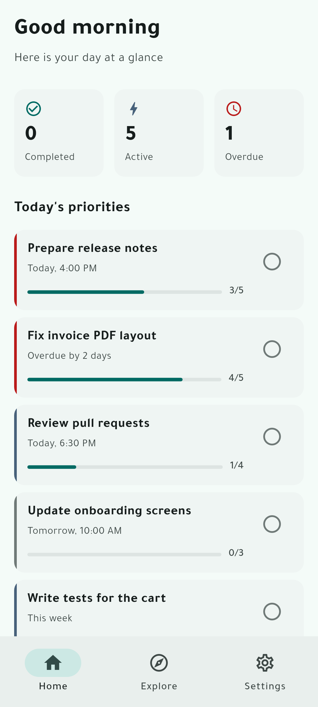
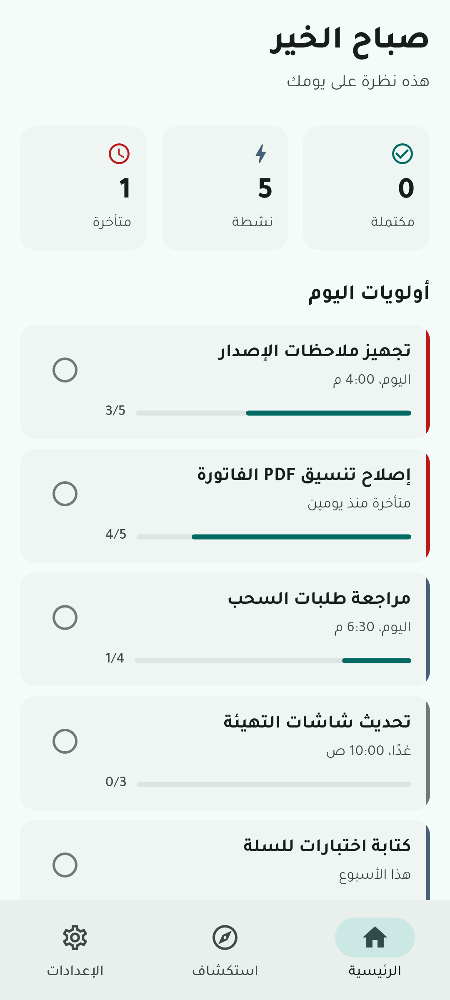
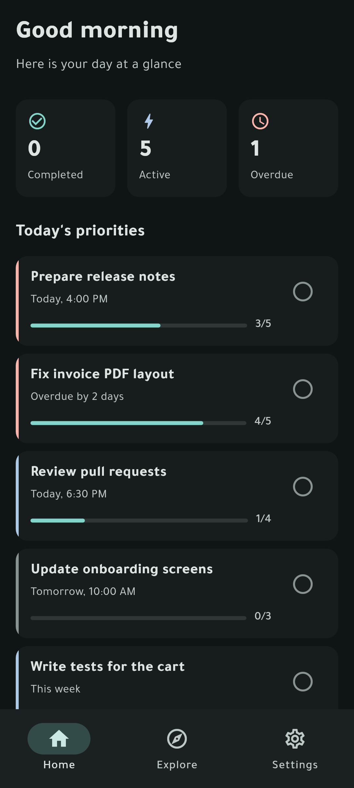
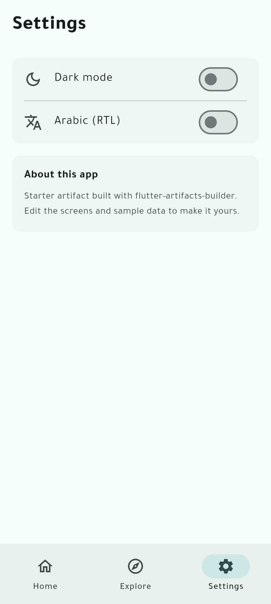

# Flutter Artifacts Builder

A skill + toolchain for building elaborate **Flutter/Dart** application artifacts - the Flutter counterpart of Anthropic's public [web-artifacts-builder](https://github.com/anthropics/skills/tree/main/skills/web-artifacts-builder) (React/HTML). Same idea, native stack: instead of bundling React into a single HTML file, you scaffold a real Flutter app, verify it with analysis, widget tests and golden screenshots, and bundle a release APK or a static web build.

**Stack**: Flutter 3.50+ / Dart 3.14+ · Material 3 (`material_ui`) · provider · flutter_lints · Tajawal font bundled (Arabic + Latin, offline)

| Home (EN) | Home (AR, RTL) | Dark | Settings |
|---|---|---|---|
|  |  |  |  |

## What you get

```
scripts/init-artifact.sh    # scaffold a project from the curated template
scripts/test-artifact.sh    # flutter analyze + widget tests + golden screenshots
scripts/bundle-artifact.sh  # release builds: dist/<name>-web.zip and/or dist/<name>-release.apk
template/                   # the starter app the init script installs
SKILL.md                    # the skill definition (workflow + design guidance)
docs/design-sources.md      # public design-skill sources reviewed, and what was applied
```

The generated project ships with:

- Material 3 theme (light + dark) from a single seed color - not the default look
- Tajawal font as a bundled asset: real Arabic and Latin typography, no runtime font downloads
- App state via provider (theme mode + locale), English/Arabic RTL toggle included
- Navigation shell with three starter screens (dashboard, explore, settings)
- Strict lints, 11 widget tests (including an accessibility test that checks labels and 48dp touch targets), and golden screenshot tests that render real fonts and icons at phone and tablet sizes

## Quick start

```bash
bash scripts/init-artifact.sh my_app
cd my_app
bash ../scripts/test-artifact.sh .                    # analyze + tests; goldens compare against the shipped references
bash ../scripts/bundle-artifact.sh . web              # apk|web|all
```

Golden screenshots are environment-sensitive. Reference renders ship with the template
(generated on Linux, Flutter 3.50.1 - the same version CI pins), so the test suite
compares against them out of the box and a visual regression fails. If your machine
renders slightly differently, regenerate once with
`bash ../scripts/test-artifact.sh . --update-goldens`, INSPECT the PNGs, and commit
your references. Do the same after any intentional visual change.

Requirements: Flutter 3.50+ on PATH. APK builds additionally need the Android SDK. The release APK is signed with the debug key - set up a real upload key before publishing anywhere.

Note on imports: since Flutter 3.47, the Material library also lives in the official [material_ui](https://pub.dev/packages/material_ui) package (verified publisher flutter.dev), and in current stable (3.50) `package:flutter/material.dart` is deprecated in its favor. The template uses the new official imports, so generated projects start on the current toolchain conventions.

## Verification status

What has actually been run on this template (Flutter 3.50.1 stable, Dart 3.14.0):

- init script: generated a project end to end, `flutter pub get` clean
- `flutter analyze`: no issues
- widget tests: 11/11 passing (including the accessibility test)
- golden screenshots: 5 renders generated and visually inspected (the ones above, plus a tablet-size home)
- `flutter build web --release`: succeeded
- the CI workflow in `.github/workflows/ci.yml` runs these same steps on every push, pinned to Flutter 3.50.1, and the golden tests compare against the committed references (verified: a deliberate color change failed the comparison; reverting it passed again)
- APK build: not run (no Android SDK or device in the verification environment)
- no app built from this template has been run on a physical device

## Why golden screenshots

Tests passing does not prove a UI looks right. The golden suite renders the app at 360x800 logical pixels with the real bundled fonts and Material icons, in light, dark and Arabic RTL states, and the workflow expects a human (or agent) to actually look at the PNGs before calling visual work done. See `docs/screenshots/`.

## License

Apache 2.0 - see [LICENSE](LICENSE) and [NOTICE](NOTICE). Inspired by (no code copied from) the Apache-2.0-licensed web-artifacts-builder by Anthropic. Bundles the Tajawal font under the SIL OFL 1.1.
